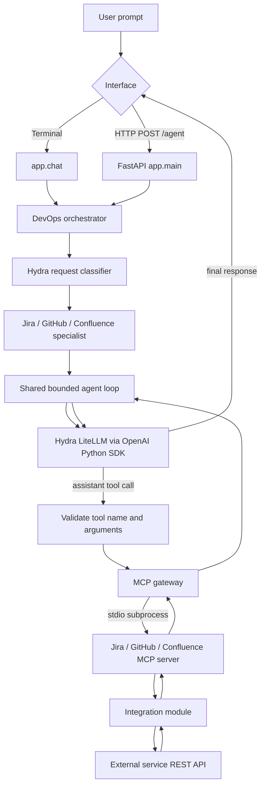

# Project Guide

This guide describes the repository as it is currently implemented. It is intended to help a new developer configure, run, understand, and extend the application. Keep it updated when tools, configuration, or request flow change.

## 1. What the project does

The Agentic Infrastructure Platform is a Python application that accepts natural-language operations requests and can use a bounded set of Jira, GitHub, and Confluence tools. Examples include finding or creating Jira issues, reading or updating GitHub issues, and searching, reviewing, commenting on, creating, or updating Confluence pages.

The language model does not directly log in to those services. The application exposes a list of typed tools to the model, validates the model's proposed tool call, and executes the corresponding application code. External service credentials stay in the app's environment. The current live model client is the OpenAI Python SDK pointed at an OpenAI-compatible Hydra/LiteLLM endpoint. The SDK still communicates with Hydra over HTTP; it is a Python client library, not a way to avoid network requests.

This is a bounded agent system, not an unrestricted autonomous service. The shared agent loop has a six-step limit and a twelve-tool-call limit per request. Jira and GitHub writes execute immediately when requested; this version does not pause for human approval.

## 2. Request and tool flow



1. The user submits a plain-language prompt from the terminal chat or sends JSON to FastAPI.
2. `devops_agent()` asks `agent_gateway.py` to classify a single-service request as Jira, GitHub, or Confluence. If classification fails or is unclear, keyword-based fallback selects a route or uses the general DevOps agent.
3. A specialist wrapper calls the shared `run_agent_loop()` with only that service's tools. General or multi-service requests receive the full tool set.
4. The loop sends conversation messages and OpenAI-compatible tool schemas to Hydra. Hydra returns either text or a tool call.
5. The application checks the requested tool and its arguments, performs additional domain validation, then invokes the matching MCP server through `MCPGateway`.
6. The MCP server calls an integration function, which contacts Jira, GitHub, or Confluence. Tool results go back to the model so it can answer or continue within the configured limits.

The three service MCP servers are currently launched as local subprocesses over MCP stdio for each tool invocation. They are internal components of this application, not network-hosted MCP endpoints for Continue.dev or another remote client.

## 3. Prerequisites and setup

- Python 3.10 or newer.
- Network access from this application machine to the Hydra/LiteLLM endpoint and to whichever external services are being used.
- Credentials and permissions for each enabled service.
- A Hydra/LiteLLM model alias that accepts OpenAI-compatible Chat Completions requests and supports function/tool calling. Continue.dev working on another machine does not automatically configure this app; use the endpoint and alias from that Hydra deployment, reachable from this app machine.

From PowerShell at the repository root:

```powershell
python -m venv .venv
.\.venv\Scripts\Activate.ps1
python -m pip install --upgrade pip
pip install -r requirements.txt
Copy-Item .env.example .env
```

Edit `.env` with your actual values. Do not commit `.env`, paste secrets into issue reports, or put live credentials in source files. `.gitignore` excludes `.env` and `.venv/`.

### Environment variables

| Variable | Purpose |
| --- | --- |
| `HYDRA_LITELLM_BASE_URL` | OpenAI-compatible API root reachable from this machine, commonly `http://<Hydra-host>:<port>/v1`. Do not use `localhost` if Hydra is on another machine. |
| `HYDRA_MODEL` | The model alias configured and served by Hydra/LiteLLM. |
| `HYDRA_API_KEY` | LiteLLM proxy key if the proxy requires client authentication. It is not automatically the upstream model-provider key. Leave empty if the proxy has no auth; the client supplies a placeholder key for SDK construction. |
| `HYDRA_TIMEOUT` | Request timeout in seconds; defaults to `120`. |
| `JIRA_BASE_URL` | Jira site root, such as `https://example.atlassian.net`; do not append an issue path. |
| `JIRA_EMAIL` | Atlassian account email used for Jira basic authentication. |
| `ATLASSIAN_API_TOKEN` | Atlassian API token. The same token can be used for Confluence if that account has product access and permissions. |
| `JIRA_PROJECT_KEY` | Default Jira project key; defaults to `AD`. Users can specify another project in the request. |
| `CONFLUENCE_BASE_URL` | Optional Confluence site root; defaults to `JIRA_BASE_URL`. |
| `CONFLUENCE_EMAIL` | Optional Confluence account email; defaults to `JIRA_EMAIL`. |
| `GITHUB_TOKEN` | GitHub token with access to selected repositories and requested operations. |
| `GITHUB_OWNER` | Default GitHub owner; current code defaults to `SubhramitaBora`. |
| `GITHUB_REPO` | Default repository; current code defaults to `Agentic-Workflow`. |
| `GROQ_API_KEY`, `GROQ_MODEL` | Legacy standalone Groq client configuration. The active agents currently call Hydra, not Groq; `test_groq.py` uses this legacy client. |

If the Hydra host is on another computer, configure the server to listen on a network interface reachable from the app machine, permit the port through the host firewall, and use the server's DNS name or LAN IP. Do not put `0.0.0.0` in the client URL; that is a server bind address, not the destination address a client connects to.

## 4. Running the application

### Interactive terminal chat

```powershell
python -m app.chat
```

At `You>` enter a normal request. Type `exit` or `quit` to stop. Example:

```text
You> Get Jira issue AD-5 and summarize its type, status, priority, and description.
```

The process must remain running while you use this terminal interface.

### FastAPI service

```powershell
uvicorn app.main:app --reload
```

Open `http://127.0.0.1:8000/docs` for Swagger UI. The primary endpoint is `POST /agent` with body:

```json
{"request":"Get Jira issue AD-5 and summarize its status and priority."}
```

The response contains `received_request` and `routing_result`. A rejected Jira or Confluence draft can return HTTP 422 with validation details. Unexpected failures return a generic HTTP 502 body; the detailed traceback is written to the server console.

### Simple Hydra connectivity check

```powershell
python test_hydra.py
```

This exercises a plain-text model request via the same Hydra client. It does not test tool calling or Jira credentials. Run the app chat with a request requiring one tool to check the tool-calling path.

## 5. Supported capabilities

### Jira

- Read a Jira issue by key.
- Search issues within a project by text and/or status.
- Create Epic, Story, Task, Bug, or Sub-task, subject to the project's issue type scheme and required Jira fields. A Sub-task requires `parent_key`; a Story can optionally be linked to an Epic.
- Update an issue's summary, description, or priority.
- Transition an issue through an available Jira workflow transition.
- Verify writes by reading the result where the agent implements write verification.

Task descriptions require meaningful `Goal`, `Acceptance Criteria`, `Definition of Ready`, and `Definition of Done` sections. Bug descriptions require `Steps to Reproduce`, `Expected Result`, `Actual Result`, `Impact`, `Definition of Ready`, and `Definition of Done`. Epic, Story, and Sub-task use a non-empty description and common Jira fields, but project-specific required custom fields may still cause Jira to reject creation. Supported priorities in the validator are Highest, High, Medium, Low, and Lowest.

### GitHub

- Get an issue, list issues, create an issue, or update an issue title/body/open-closed state.
- Get repository metadata.
- Read pull request metadata.

This integration does not currently create or update pull requests, review code, or add issue comments.

### Confluence

- List spaces, search pages, read a page, and list a folder's direct children.
- Create pages and folders (folders are container entries; verify availability for your Confluence site/account).
- Rename a page, replace its title/body, and clean grammar/organization while attempting to preserve storage markup and facts.
- Review a page and add inline comments for uniquely anchored text or page-level comments for findings without a body-text anchor.
- Read existing inline/footer comments.

Technical page creation/update uses a team policy in `confluence_validator.py`: title format `[Category] – [Specific Topic]`, one of AI/LLM, RAG, MCP, DevOps/SRE, Infrastructure, or Integrations; required headings Overview, Purpose, Key Concepts, How It Works, Example, Common Problems, and Related Topics; and abbreviation-expansion checks for RAG, MCP, TTFT, and KV cache. The validator enforces these deterministic checks; it is not a general factual truth checker. The AI review can suggest issues but may miss or incorrectly flag them.

There is no scheduled daily scan, Microsoft 365 email notification, automatic assignment workflow, or Confluence folder rename tool in the current source.

## 6. Guardrails and behavior

- Tool schemas constrain model-proposed arguments; the application separately checks the tool allowlist for the current specialist.
- Agent execution is limited to `MAX_AGENT_STEPS = 6` and `MAX_TOOL_CALLS = 12` in `devops_agent.py`.
- Jira issue creation uses `validate_jira_issue()` before the create request and checks parent type/project relationships when a parent key is supplied.
- Confluence page create/update and rename paths apply page policy checks; cleanup also validates the resulting storage body before updating.
- Update paths check required identifiers/fields and often read the current object before changes. The code includes write/read-back verification for several operations.
- Create/update/transition tools have real side effects and execute without a confirmation prompt. Use a development Jira project/repository/space while evaluating them.
- Tool output and page contents are treated as data in prompts, but model output is not guaranteed to be correct. Review updates, transitions, and newly created content in the external service.

## 7. File-by-file map

### Application and configuration

| File | Responsibility |
| --- | --- |
| `app/__init__.py` | Marks `app` as a Python package so `python -m app.chat` and module imports work. |
| `app/main.py` | FastAPI application, lifespan cleanup for the Hydra SDK client, health/root route, request schema, and `POST /agent`. |
| `app/chat.py` | Interactive terminal loop that sends each entered prompt to `devops_agent()` and prints the result. |
| `app/config.py` | Loads `.env` and exposes Jira, Confluence, GitHub, and Hydra settings. This module should contain names/defaults, never literal secrets. |
| `app/models/requests.py` | Request model module. Check whether it is used before changing it; the active FastAPI request model currently lives in `app/main.py`. |
| `app/gateway/__init__.py` | Empty package marker/reserved gateway package; current routing logic is in `app/agents/agent_gateway.py`. |
| `requirements.txt` | Python dependencies for FastAPI, HTTPX integrations, the OpenAI SDK, Groq legacy client, dotenv, Pydantic, and MCP. |
| `.env.example` | Safe template showing required setting names and placeholder values; copy to `.env`. |
| `.gitignore` | Excludes `.env`, `.venv/`, Python bytecode, and cache files. |

### Agents, routing, and validation

| File | Responsibility |
| --- | --- |
| `app/agents/__init__.py` | Package marker for agents. |
| `app/agents/devops_agent.py` | Central tool schemas, bounded agent loop, tool dispatch, service scoping, argument/write validation, Confluence cleanup/review/rename helpers, output handling, and orchestration/delegation. |
| `app/agents/agent_gateway.py` | Asks Hydra to classify a request as Jira, GitHub, Confluence, or general DevOps; includes a keyword fallback. Despite “gateway” in its name, it is a classifier, not the MCP gateway. |
| `app/agents/jira_agent.py` | Jira specialist wrapper. Calls the shared loop with Jira tools only. |
| `app/agents/github_agent.py` | GitHub specialist wrapper. Calls the shared loop with GitHub tools only. |
| `app/agents/confluence_agent.py` | Confluence specialist wrapper. Calls the shared loop with Confluence tools only. |
| `app/agents/issue_validator.py` | Deterministic Jira create validation for type, project key, summary, priority, description, parent requirement, and Task/Bug templates. |
| `app/agents/confluence_validator.py` | Deterministic Confluence title/category, required heading, and abbreviation checks. |

The three service agents are thin specialized entry points over one shared model/tool loop. They are separate routed agent roles, not separate independent model runtimes with their own separate planning implementations.

### Model clients

| File | Responsibility |
| --- | --- |
| `app/llm/hydra_client.py` | Creates a reusable `AsyncOpenAI` client configured with Hydra's OpenAI-compatible LiteLLM base URL, model alias, optional proxy key, and timeout. Provides text-only and tool-aware chat methods and closes the client on application shutdown. |
| `app/llm/groq_client.py` | Legacy Groq SDK client. The active router and agent import Hydra; this file remains for the standalone Groq smoke script unless deliberately removed. |

### MCP servers and gateway

| File | Responsibility |
| --- | --- |
| `app/mcp/__init__.py` | Package marker for MCP components. |
| `app/mcp/gateway.py` | Starts the selected service MCP server as a stdio subprocess, initializes an MCP client session, and calls its tool. |
| `app/mcp/jira_server.py` | Registers Jira functions as MCP tools: create/get/search/update issues and transition issue status. |
| `app/mcp/github_server.py` | Registers GitHub functions as MCP tools: create/get/list/update issues, get repository, and read pull request. |
| `app/mcp/confluence_server.py` | Registers Confluence functions as MCP tools: list spaces, search/read pages, create pages/folders, list folder children/comments, add comments, and update pages. |

### External-service integrations

| File | Responsibility |
| --- | --- |
| `app/integrations/__init__.py` | Package marker for external-service integrations. |
| `app/integrations/jira.py` | HTTPX-based Jira REST client using Jira site URL, Atlassian email, and API token. Handles create metadata lookup, issue create/read/search/update, and workflow transitions. |
| `app/integrations/github.py` | HTTPX-based GitHub REST client using a GitHub token. Handles issue/repository/pull-request reads and issue create/update. |
| `app/integrations/confluence.py` | HTTPX-based Confluence REST client using Atlassian email/token. Handles space/page/folder operations, inline/footer comments, and page updates. |

The OpenAI SDK is used for the model connection only. Jira, GitHub, and Confluence integrations currently use HTTPX directly behind the MCP tools; MCP itself is the tool protocol and server/client framework.

### Manual scripts and tests

| File | Purpose / caution |
| --- | --- |
| `test_hydra.py` | Manual plain-text Hydra connection smoke script; does not test tool calling. |
| `test_groq.py` | Manual Groq smoke script using the legacy Groq client and `GROQ_API_KEY`; unrelated to the active Hydra agent path. |
| `test_gateway.py` | Manual Jira MCP gateway example. It requests a hard-coded issue key; edit it and ensure access before running. |
| `test_jira_agent.py` | Earlier Jira-agent manual script. Its current call style may be stale because `jira_agent()` is async; prefer the supported terminal or FastAPI interface unless updating this script. |
| `test_mcp_client.py` | Manual MCP client check that starts the Jira MCP server and lists its tools. |
| `test_mcp_gateway.py` | Manual external-service MCP gateway example, including a repository call with empty args even though the tool needs owner/repo; likely needs updating before use. |
| `tests/test_issue_validator.py` | Unit tests for Jira issue validation. Check test expectations against the current policy before relying on them: some sample Task descriptions in this file may omit Definition of Ready/Done while the current validator requires both. |
| `code.txt` | Local scratch/config text, not imported by the application. Do not use it as configuration or commit it if it contains personal or credential-related values. |

Manual scripts can contact real external services. They are not all isolated unit tests. The dedicated validator tests can be run with `python -m unittest discover -s tests`, after reviewing their current expectations.

## 8. Adding or changing a tool

For a new external-service action:

1. Implement/adjust the HTTPX operation in `app/integrations/<service>.py`, keeping inputs narrow and validating them before sending a request.
2. Register a typed wrapper with `@mcp.tool()` in `app/mcp/<service>_server.py`.
3. Add a matching OpenAI-compatible function schema to `TOOLS` in `app/agents/devops_agent.py`.
4. Route the tool name to the appropriate MCP gateway method in `_execute_tool()` and include it in the correct specialist's allowed tool scope.
5. Add preconditions/validation for writes, plus read-back verification when the service supports it.
6. Update this guide and add focused tests if requested by the maintainer.

## 9. Known constraints and handoff notes

- `HYDRA_MODEL` must exactly match a model alias Hydra/LiteLLM serves. The client base URL must be reachable from the application machine and should be the API root, normally ending in `/v1`.
- A working text completion alone does not prove model tool calling works. The selected model and Hydra/LiteLLM routing configuration must support the OpenAI-compatible tool format used in `chat_with_hydra()`.
- Jira project issue types, workflow transitions, permissions, custom fields, and priority names vary by project. The integration checks create metadata for the issue type, but project-required custom fields are not modeled here.
- The project has no approval workflow for external writes. Changes can take effect as soon as the user request is processed.
- No daily Confluence scan, email notification system, automatic user assignment, remote MCP deployment, persistent chat memory, or central audit database is implemented in this repository.
- `test_groq.py` and `groq_client.py` are leftovers from the earlier model provider path. Do not mistake them for the active runtime provider.

## 10. Safe reproduction checklist

1. Clone/copy the repository and install `requirements.txt` in a virtual environment.
2. Copy `.env.example` to `.env`; set only the integrations needed for the reproduction.
3. Confirm a plain-text Hydra call with `python test_hydra.py`.
4. Start `python -m app.chat` and try a read-only request first, such as reading a known Jira issue or repository.
5. Verify that the result comes from the external service; do not assume a model-generated success message proves the operation happened.
6. Use a sandbox/test project and repository for create/update/transition requests. These operations execute immediately and may modify real data.
